# Sauna hat 3D prints

Free, parametric 3D-printable accessories for a wool sauna hat and the sauna around it, from [DIVELUX](https://diveluxsaunahat.com), makers of handmade wool felt sauna hats.

| | Model | Parts |
|---|---|---|
| 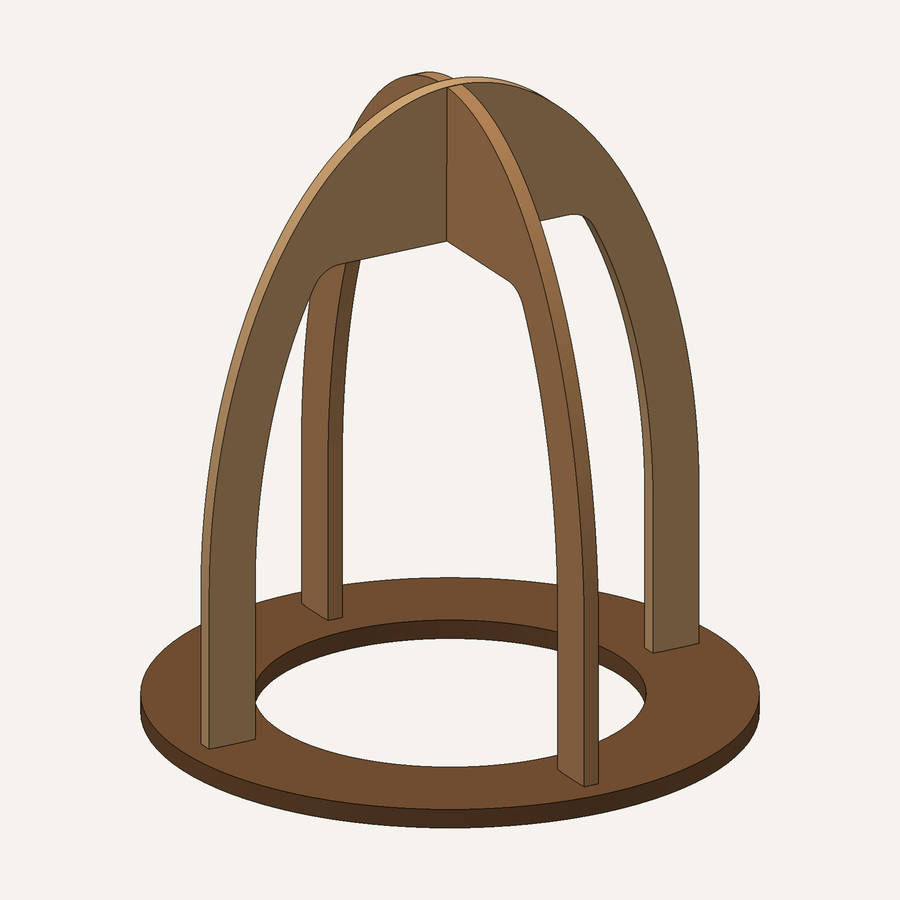 | **[Sauna hat drying stand](sauna-hat-drying-stand/)**: two flat arches that slot together plus a base ring. Holds the shape of a bell hat and lets air through. 186 × 186 × 204 mm assembled. | 3, no glue |
| 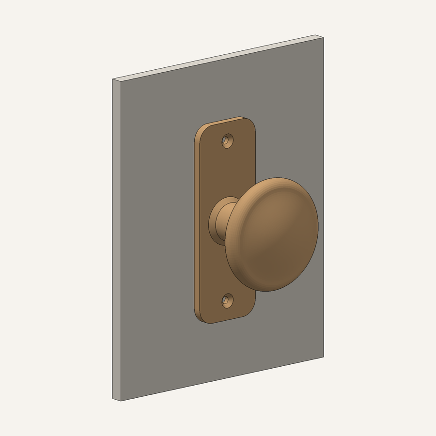 | **[Sauna hat hooks](sauna-hat-hook/)**: a wall hook with a wide 70 mm mushroom cap that does not dent felt, and over-the-door hooks for 35 mm and 45 mm doors or a 20 mm rail. | 1 each |
| 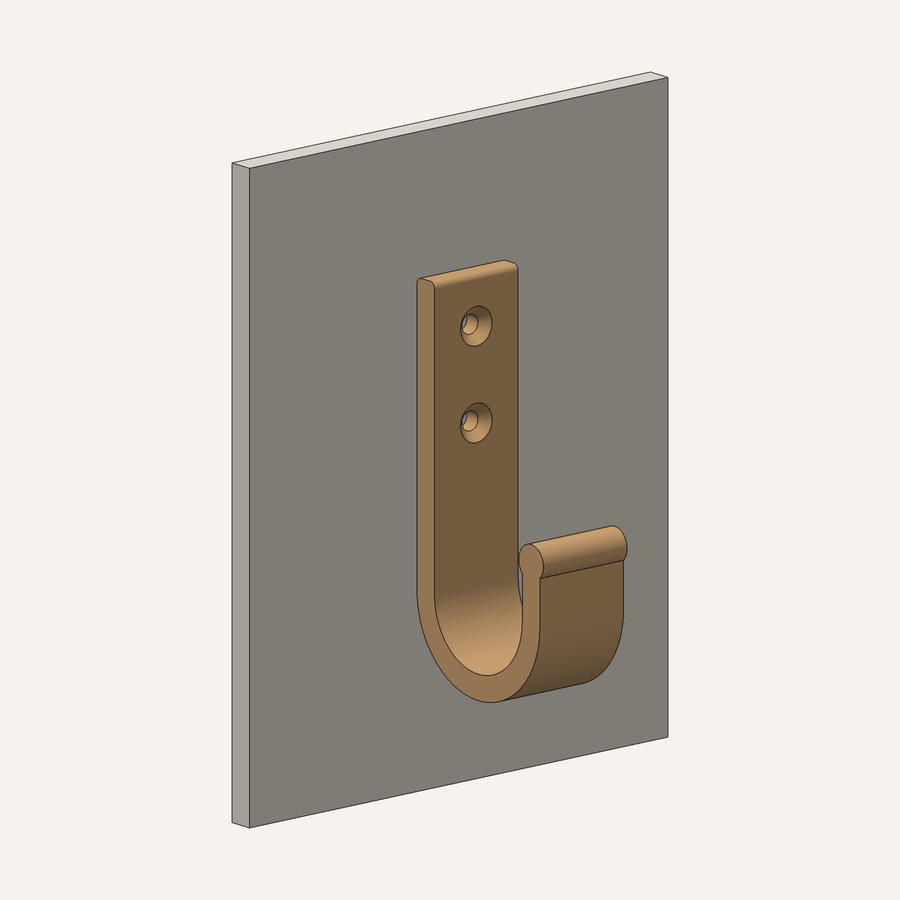 | **[Ladle and bucket hook](sauna-ladle-hook/)**: a simple J-hook, two screws, 30 mm opening. | 1 |
| 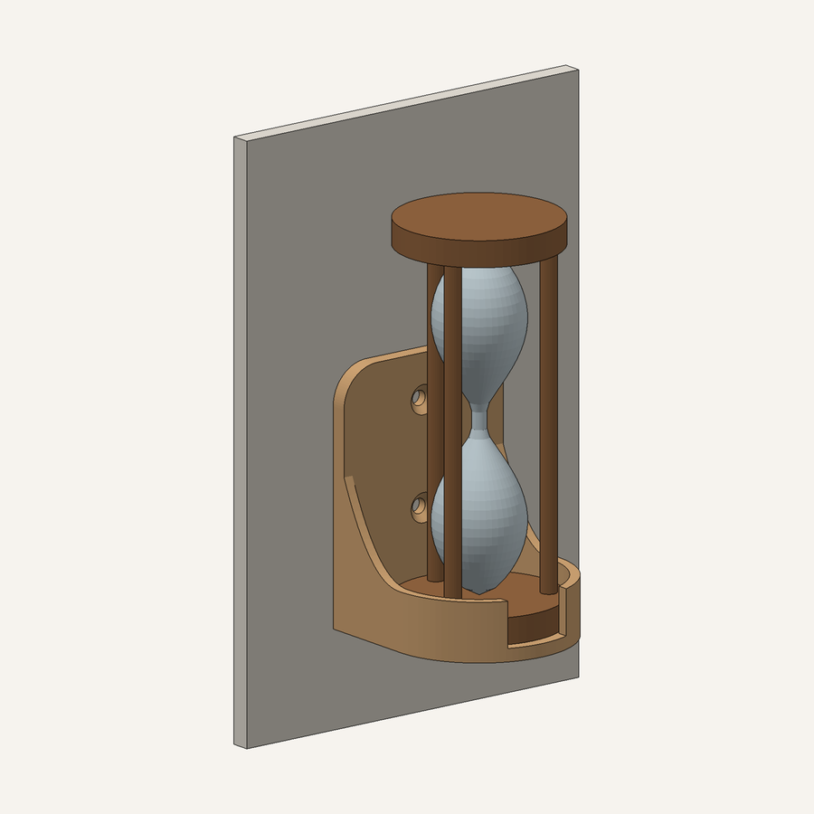 | **[Sand timer wall shelf](sauna-sand-timer-shelf/)**: a small cup on a back plate for a free-standing sand timer; lift it out, flip it, set it back. Files for 40, 50 and 60 mm timers. Print in ASA or PC for the hot room. | 1 |
| 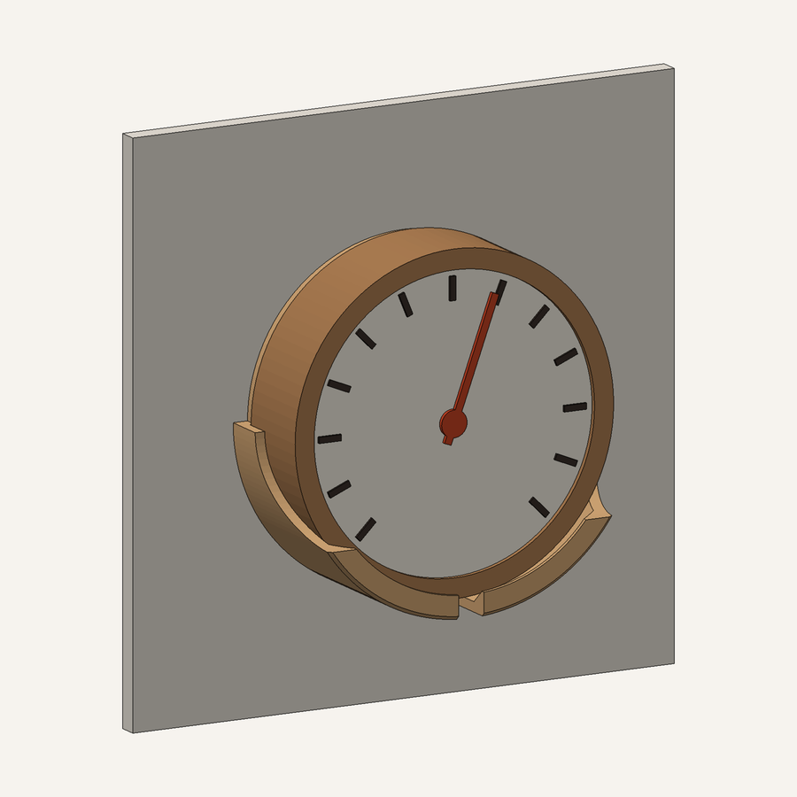 | **[Thermometer / hygrometer cradle](sauna-thermometer-cradle/)**: a half-round wall cradle with an open back; the gauge drops in from above. Files for 100, 120 and 130 mm gauges. Print in PC or ASA for the hot room. | 1 |
| 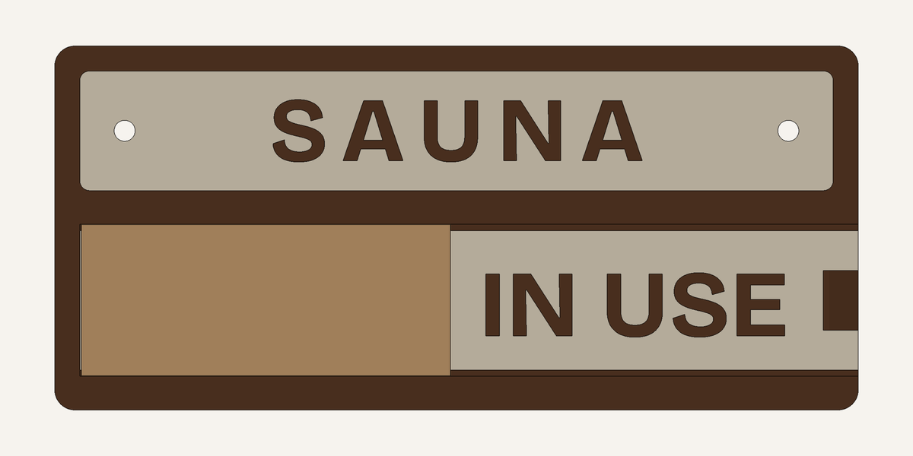 | **[Door sign with slider](sauna-door-sign-slider/)**: FREE / IN USE. The slider runs in a dovetail track and clicks in past a catch. 161 × 73 mm, two-color letters with one filament swap. | 2, no glue |
| 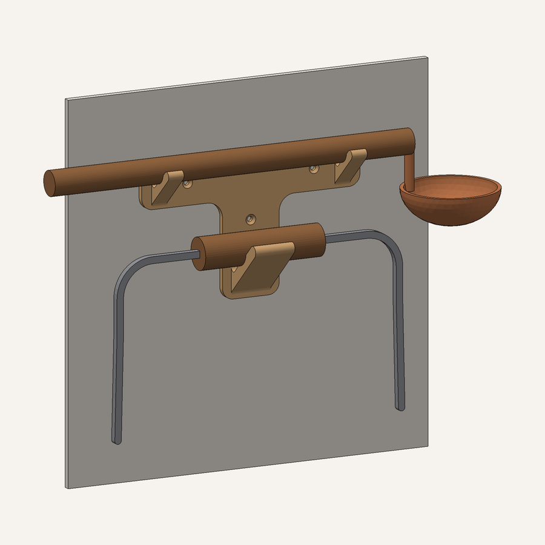 | **[Bucket and ladle rack](sauna-bucket-ladle-rack/)**: a T-shaped plate with three 45-degree arms. The bucket hangs by its handle on the center hook, the ladle lies across two forks above it. 200 × 122 mm. | 1 |
| 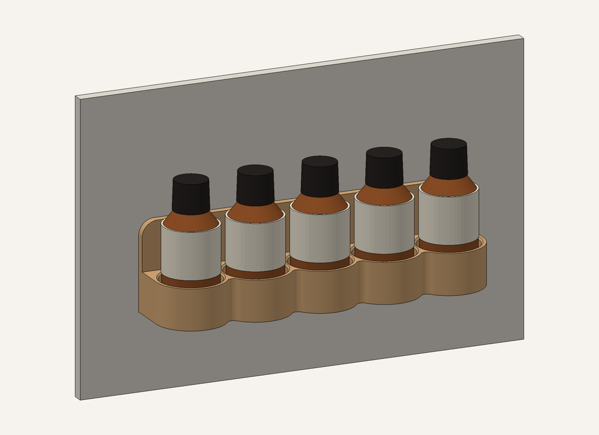 | **[Essential oil bottle rack](sauna-oil-bottle-rack/)**: a row of cups on a back plate for 4, 5 or 6 bottles up to 30 mm wide. | 1 |
| 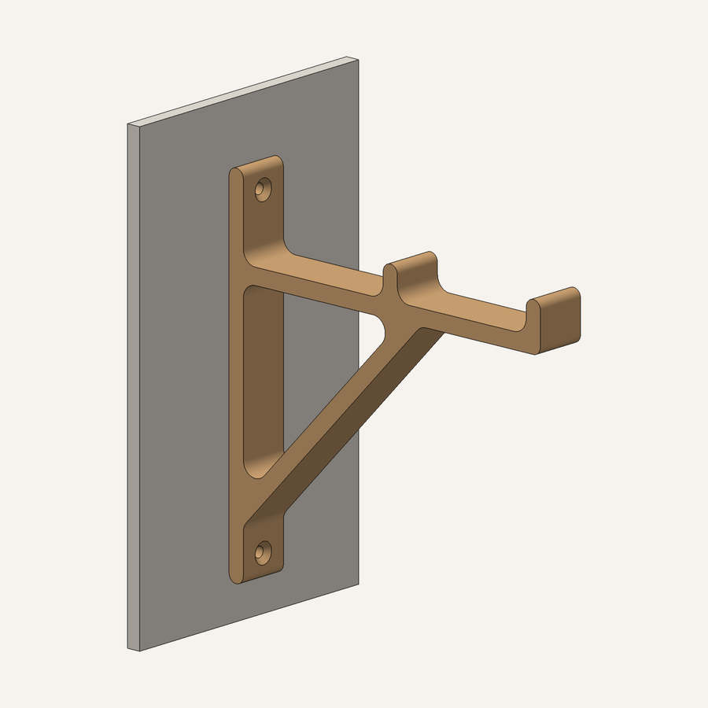 | **[Whisk drying arm](sauna-whisk-hanger/)**: a braced arm that holds one or two whisks (vihta / venik) 150 mm off the wall, leaves down. | 1 |
| 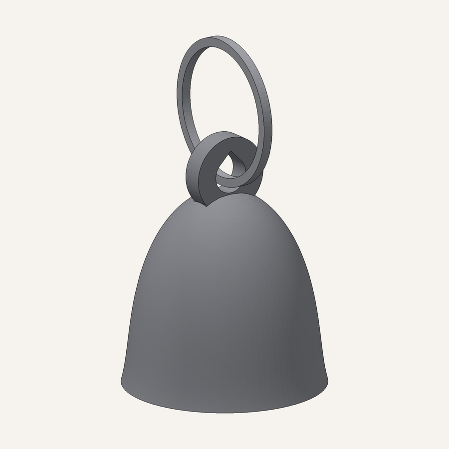 | **[Mini sauna hat keychain](mini-sauna-hat-keychain/)**: a tiny bell hat with a loop for a key ring, as a hollow 3D hat (34 × 42.5 mm) and as a flat tag. | 1 each |
| 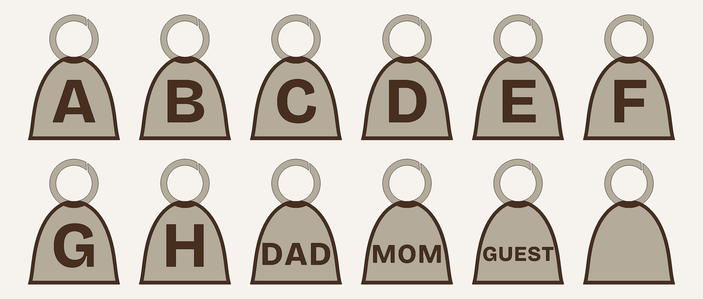 | **[Hat name tags](sauna-hat-name-tags/)**: hat-shaped tags with a split ring that twists onto the hanging loop of a hat. A to H, DAD, MOM, GUEST, blank, or your own text. | 1 each |
| 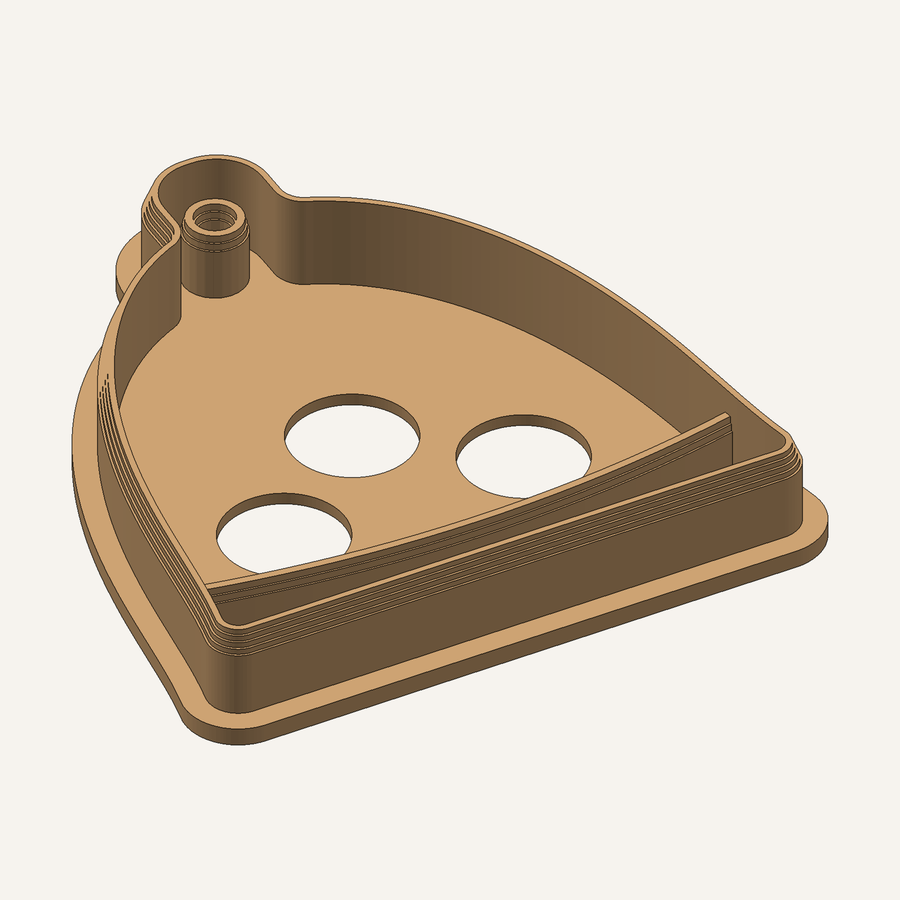 | **[Sauna hat cookie cutter](sauna-hat-cookie-cutter/)**: a 75 × 81 mm bell hat cookie; plain outline, or with a back plate that presses in the brim and the loop. | 1 each |

Each folder has `stl/`, `3mf/`, preview images and the Python source (`manifold3d` + `trimesh`; shared helper `dvx_cad.py` in the repo root). Change the parameters at the top of the source file and run it to regenerate the meshes.

Models with lettering or the hat silhouette (door sign, name tags, keychain, cookie cutter) also use `dvx_text.py`, which needs `fonttools` and any bold TrueType font: set the `DVX_FONT` environment variable to a .ttf file, or let it pick a system font. There is also a companion set of laser-cut files: a wooden SAUNA door sign and a plywood version of the drying stand.

## Printing

- FDM, 0.4 mm nozzle, 0.2 mm layers, 3 perimeters, 15–20% infill, no supports.
- PLA or PETG. **Keep printed parts out of the hot room**: both soften in sauna heat. They belong in the changing room, where the hat dries anyway.
- Two parts are meant for the hot room itself: the sand timer shelf and the gauge cradle. Print those in ASA or polycarbonate and keep them away from the heater, or use them outside the hot room. Their listings say exactly where each material stops.
- The cookie cutter touches food: read the care notes in its listing.

## About the hat

A wool felt sauna hat is worn dry and air-dried after each visit, which is what the stand and hooks are for. Read more in the free [Sauna Hat Guide](https://github.com/divelux/sauna-hat-guide), or see more free sauna tools at https://diveluxsaunahat.com/pages/sauna-tools.

## License

[CC BY 4.0](https://creativecommons.org/licenses/by/4.0/). Credit DIVELUX with a link to https://diveluxsaunahat.com.
