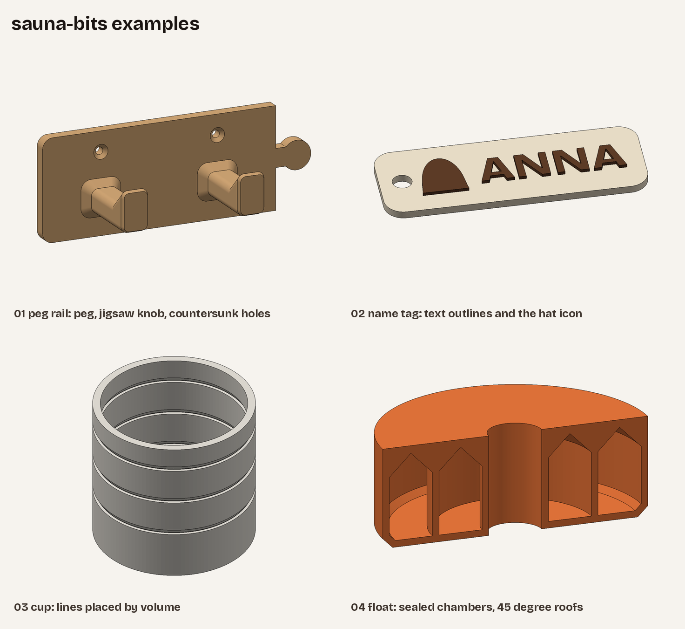

# sauna-bits

Small parametric building blocks for 3D-printable sauna accessories, in plain Python on top of [manifold3d](https://github.com/elalish/manifold) and [trimesh](https://trimesh.org). It is the shared code behind the free DIVELUX sauna prints: hooks, signs, a measuring scoop, a thermometer float, a felting form and more. Made by [DIVELUX](https://diveluxsaunahat.com), makers of handmade wool sauna hats.



Every block is designed to print **without supports** in the orientation its docstring gives, and the tests check that each one comes out as a closed (watertight) mesh with nothing facing down more than 45 degrees above the bed.

## Install

```
pip install manifold3d trimesh numpy        # required
pip install fonttools pillow                # optional: text outlines, preview pictures
```

Then put this folder on your `PYTHONPATH`, or run `pip install .` here. Text needs any bold TrueType font: set `DVX_FONT=/path/to/font.ttf`, drop one into `sauna_bits/fonts/`, or let it find a system font (DejaVu, Liberation, Arial).

## What is inside

| Module | What it gives you |
|---|---|
| `sauna_bits.cad` | 2D shapes (`poly`, `rect`, `circle`, `rounded`, `filleted`, `clean`, `stroke`, `arc`), `along_x` extrusion, conversions (`to_trimesh`, `to_manifold`), `export` (STL + 3MF, re-read like a slicer would), `report`, `overhang_area`, `printcheck` |
| `sauna_bits.text` | `text()`: a line of text as 2D outlines from any .ttf; `bell_hat()`: the bell sauna hat silhouette |
| `sauna_bits.parts` | `countersunk_hole`, `teardrop_hole`, `pilot_hole`, `jigsaw_knob`, `dovetail_profile`, `spigot_tube`, `peg` (towel peg with a rising tip), `cup_cavity` + `level_for_volume` (volume lines), `v_groove_ring`, `cone_cavity` (support-free hollowing), `gable_ring_cells` (sealed float chambers) |
| `sauna_bits.render` | a tiny software renderer for preview pictures (no GPU, no Blender) |

All sizes are millimeters; z is up on the print bed.

## Examples

Run them from this folder; they write STL and 3MF files to `examples/out/` and print the check.

```
python3 examples/01_peg_rail.py          # two pegs, countersunk holes, a jigsaw knob to join the next rail
python3 examples/02_name_tag.py ANNA     # raised text and a hat icon, two colors with one filament swap
python3 examples/03_measuring_cup.py     # volume lines at 20/40/60 ml, measured on the exported STL
python3 examples/04_float.py             # a float with sealed chambers, buoyancy from the mesh volumes
python3 examples/gallery.py              # redraws img/gallery.png
```

A minimal script:

```python
from sauna_bits import cad, parts

plate = cad.rounded(cad.rect(-40, -25, 40, 25), 6).extrude(6)
plate += parts.peg(length=45, lip=10).translate((0, -5, 5.99))
plate -= parts.countersunk_hole(plate_t=6).translate((0, 17, 0))
cad.printcheck("hook", cad.export(plate, "out", "hook"))
```

Output:

```
hook                               watertight=True winding=True bodies=1 size=80.0 x 50.0 x 51.0 mm volume=34.9 cm3 faces=1880
                                   fits 220 mm bed=True  overhang beyond 45 deg=0.0 mm2  -> OK
```

## Tests

```
python3 tests/test_watertight.py         # or: pytest -q
```

Each block is built into a small part and checked: watertight, consistent winding, one piece (one piece plus sealed chambers for the float), lowest point on z = 0, no overhang beyond 45 degrees. The joint tests also check that a knob and its socket, and a dovetail slider and its track, do not overlap at the given clearance. The volume test checks that `level_for_volume` hits the volume within 0.05 ml.

## Printing notes

The blocks print in PLA or PETG with a 0.4 mm nozzle. PLA softens at about 55–60 °C (130–140 °F) and PETG at about 75–80 °C, so anything you make for the hot room itself needs ASA or polycarbonate, or should stay outside it. More free sauna tools and the finished models: https://diveluxsaunahat.com/pages/sauna-tools

## License

MIT (see LICENSE). The STL models in the parent repository are CC BY 4.0. Made by DIVELUX — https://diveluxsaunahat.com
